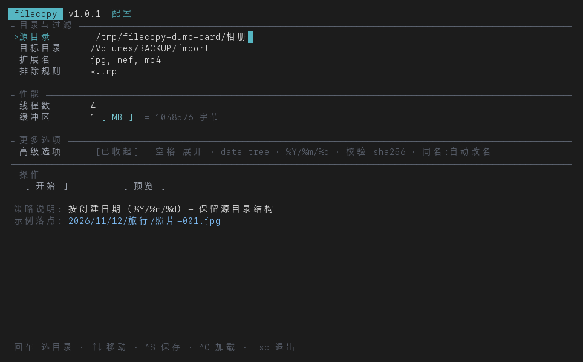
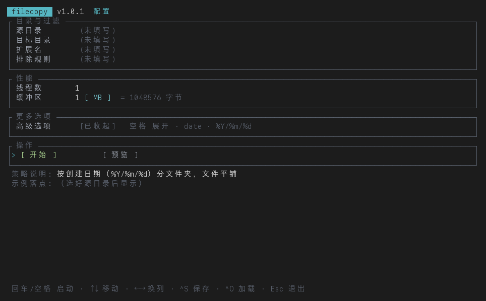
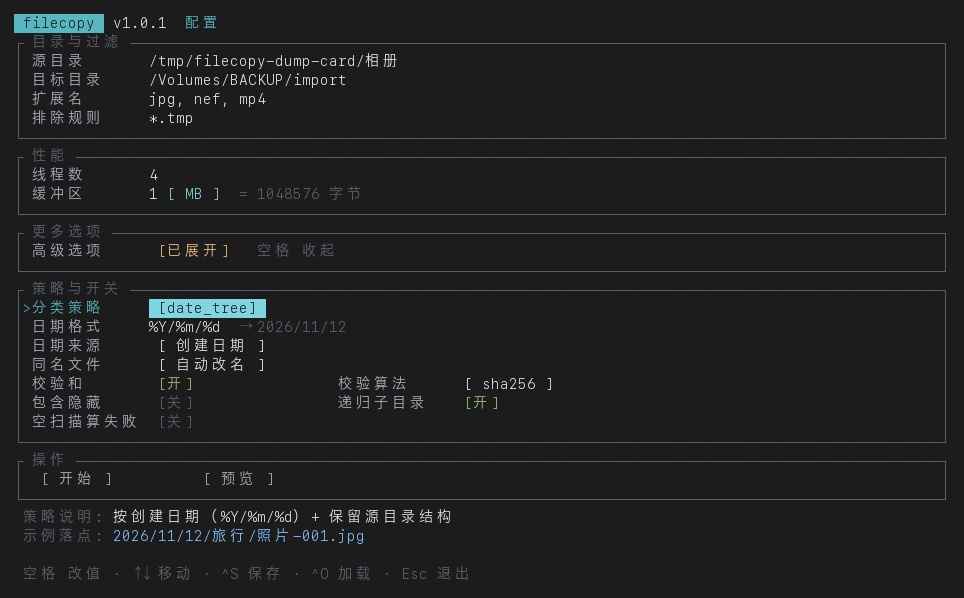
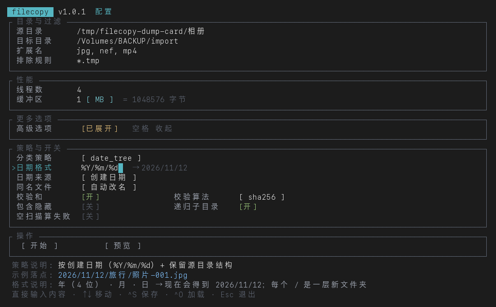
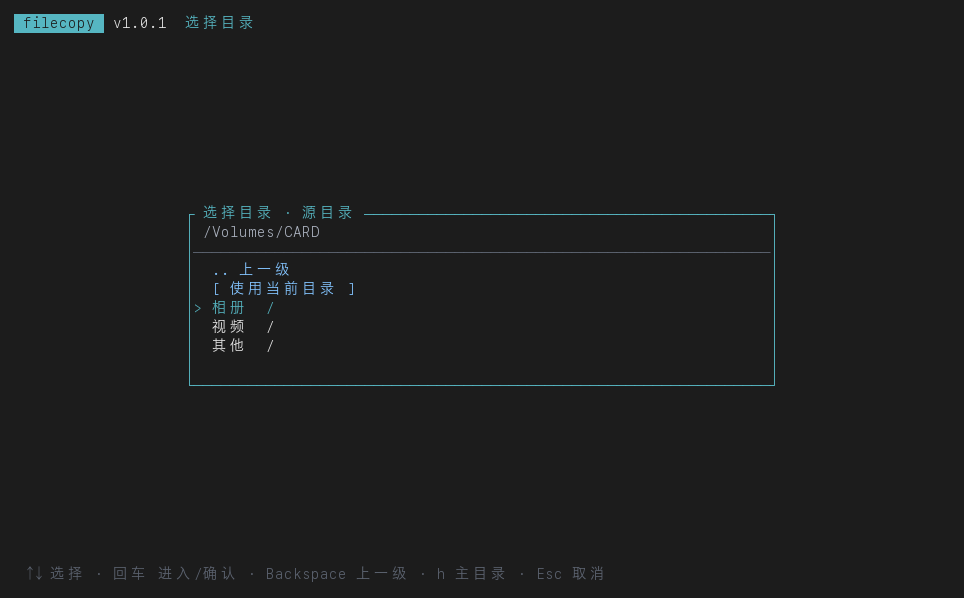
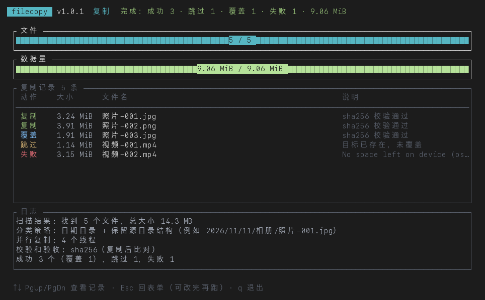

# filecopy-rs

文件归档工具 —— 按策略进行归档

选好源目录和目标目录，按底部的「开始」：按日期 / 扩展名 / 原目录结构把文件分门别类复制过去，
边复制边校验，同名冲突有明确的处理方式，全程一个界面搞定。

```
    ______ ____ __     ______ ______ ____   ____ __  __
   / ____//  _// /    / ____// ____// __ \ / __ \\ \/ /
  / /_    / / / /    / __/  / /    / / / // /_/ / \  /
 / __/  _/ / / /___ / /___ / /___ / /_/ // ____/  / /
/_/    /___//_____//_____/ \____/ \____//_/      /_/
```

## 安装

从 Releases 下载对应平台的压缩包，解压即用（单文件、无运行时依赖）：

| 平台 | 归档 | 说明 |
| --- | --- | --- |
| Linux x86_64 | `filecopy-v<版本>-linux-x86_64.tar.gz` | musl 静态链接，不挑 glibc 版本 |
| macOS | `filecopy-v<版本>-macos-universal.tar.gz` | arm64 + x86_64 通用二进制（Apple Silicon / Intel 都能跑） |
| Windows x86_64 | `filecopy-v<版本>-windows-x86_64.zip` | MSVC 构建 |

每个 Release 附带 `SHA256SUMS.txt`，解压前可以校验一下：

```bash
shasum -a 256 -c SHA256SUMS.txt        # macOS / Linux
```

macOS 首次运行若被 Gatekeeper 拦下（下载的二进制没有签名），执行：

```bash
xattr -d com.apple.quarantine ./filecopy
```

## 构建与运行

```bash
cargo build --release
./target/release/filecopy            # 打开配置界面
./target/release/filecopy --config last.json   # 用已有配置预填界面
./target/release/filecopy -V         # 版本
./target/release/filecopy -h         # 帮助 + 快捷键
```

只支持交互式终端（TUI）：`stdin`/`stdout` 不是 tty 时直接以退出码 2 报错退出，
不会在管道里悄悄跑。所有选项都在界面里完成。

## 界面

单屏状态机，五个模式：**表单 → 目录浏览器 / 配置选择 / 保存文件 → 运行界面**。



表单默认只放常用的几项（目录与过滤 / 线程数与缓冲区），策略、校验、冲突处理、隐藏文件这些
收在「高级选项」里，按 `空格` 展开，再按一次收起；展开的内容就出现在这一行**下面**。
收起时该行会摘要显示当前生效的高级设置
（例如 `date_tree · %Y/%m/%d · 校验 sha256 · 同名:自动改名`），不会有「藏起来的选项偷偷生效」的情况。

底部「操作」区是**两个启动按钮**：`[ 开始 ]` 真正复制，`[ 预览 ]` 只按计划走一遍不写任何文件。
↑↓ 移动到按钮上，回车或空格触发；`←` `→` 在两个按钮之间切换。停在哪一项上，就启动哪一个。







展开后开关两列排布，`←` `→` 在左右两列之间移动，`空格` 改值。
互相依赖的选项会自动出现或消失：日期格式与日期来源只在按日期分类的策略下显示，
校验算法只在打开校验时显示。日期格式后面会直接标出它算出来的样子（`%Y/%m/%d → 2026/11/11`），
光标停在这一项上时底部还会把格式符逐个人话翻译一遍。底部实时显示当前策略会落到什么位置；
终端矮到放不下时整张表单会跟着当前字段滚动，不会把字段切掉。





> 这些图不是截屏，而是用 `TestBackend` 把界面渲染进内存缓冲区后导出的，
> 所以跟真实终端逐字符一致，也能在 CI 上重新生成：
>
> ```bash
> FILECOPY_DUMP=/tmp/shots cargo test --lib dump_screens
> python3 tools/screenshot.py /tmp/shots /tmp/shots   # 需要 Pillow
> ```

底部页脚会跟着当前字段变化：光标停在哪里，最前面就提示那个字段能做什么
（路径上是「回车 选目录」，开关上是「空格 切换开关」，按钮上是「回车/空格 启动」……），
并且只在并排的行上才提示「←→ 换列」。

| 按键 | 作用 |
| --- | --- |
| `Tab` / `↑` `↓` | 移动字段（表单内循环） |
| `←` `→` | 在并排的两列之间移动（文本字段里仍是移动光标） |
| `空格` | 改值：开关切换、策略/算法/同名文件循环、展开或收起「高级选项」；在启动按钮上＝启动 |
| `回车` | 路径字段打开目录浏览器；开关字段切换；策略/算法/同名文件字段循环；在启动按钮上＝启动 |
| `Ctrl-S` / `Ctrl-O` | 保存 / 加载配置（文件名自动补 `.json`） |
| `Esc` | 表单里退出；运行中＝请求中断；结束后回表单 |
| `Ctrl-C` / `Ctrl-Q` | 随时退出 |
| `↑` `↓` `PgUp` `PgDn` `Home` `End` | 运行界面里翻复制记录 |

运行界面：两条进度条（文件数 / 数据量），中间是可滚动的复制记录表
（动作 / 大小 / 说明 / 文件名），底部日志区显示最近 5 行。记录表默认跟随最新一行，
手动往上翻就暂停跟随，翻回底部自动恢复。

`[ 预览 ]` 按钮只打印前 12 条落点预览，不写任何文件，标题栏会注明「预览完成」；
两条进度条会照样走完，用来确认计划覆盖到哪些文件。
预览是「这一次运行」的属性，界面上没有对应的开关——想真复制就按 `[ 开始 ]`。

## 缓冲区大小

「性能」区里的缓冲区一行搞定：数字后面直接跟单位，再往后是换算出的字节数：

```
缓冲区    1 [ MB ]  = 1048576 字节
```

数字随便填（只收数字），单位在同一行用空格在 `B → KB → MB → GB` 之间循环。
有效范围是 4 KB – 64 MB，`0` 表示交给引擎用默认值（1 MiB）；
越界或填了非数字会留在表单里报错，不会被悄悄夹到边界值——这点和引擎内部的兜底不同。

从配置里读回来时会拆成「尽量大的整数单位」，比如 1048576 显示成 `1 MB`、262144 显示成 `256 KB`。

## 分类策略

| 策略 | 落点 | 说明 |
| --- | --- | --- |
| `date` | `2026/11/11/文件.jpg` | 按日期平铺到日期目录 |
| `date_tree` | `2026/11/11/子目录/文件.jpg` | 日期目录 + 保留源目录结构 |
| `flat` | `文件.jpg` | 全部平铺到目标根 |
| `tree` | `子目录/文件.jpg` | 原样保留源目录结构 |
| `ext` | `jpg/文件.jpg` | 按扩展名（无扩展名进 `no_ext`） |

表里的 `文件.jpg` 只是示意。界面底部的「示例落点」不是拼出来的字符串，而是**按当前设置真算一遍**：
在源目录里找第一个会被复制的文件，用它的真实文件名和目录结构，配上你填的日期格式、日期来源和当前策略，
算出「真开始复制时它会去哪」——和引擎规划阶段调的是同一份代码，输入也是同一份配置
（`~`、环境变量、复制的路径带引号都会先展开）。

还没选源目录时这一行只显示「（选好源目录后显示）」，不硬编路径；源目录选好了但里面还没有匹配文件时，
退化成 `文件.<扩展名>`（取「扩展名」里的第一个，没填就不带后缀），并标注「占位示例，源目录里暂无匹配文件」，
不会假装扫到了文件。

日期格式默认 `%Y/%m/%d`，可填任意 strftime 组合（`%Y-%m`、`%Y/%m/%d_%H`、`%Y` …）。
未知格式符、结尾的 `%`、能生成绝对路径或 `..` 的格式都会被拒绝 —— 后两者是为了不让文件跑到目标目录外面。

`date` / `date_tree` 默认用文件的**创建时间**，可以在「日期来源」里改成**修改时间**——
只取文件系统里的通用时间戳，不读 EXIF：视频、RAW、文档都可能没有 EXIF，
而创建/修改时间是所有文件都有的属性。

有些文件系统（部分 Linux 挂载、网络盘）不给创建时间，这时自动退回修改时间，
并且整个进程只提示一次，而不是每个文件刷一遍。

## 目标冲突

界面里的「同名文件」是一个三选一，取代了原来「覆盖同名」「自动改名」两个独立开关
（两个都打开时语义互相打架，不知道到底该覆盖还是该改名）：

| 取值 | 遇到同名目标 | 配置里的两个布尔 |
| --- | --- | --- |
| `跳过`（默认） | 先来者占位，后来的记为「跳过」，并写出「与 `X` 映射到同一目标」 | `overwrite=false` `auto_rename=false` |
| `覆盖` | 用源文件替换目标 | `overwrite=true` `auto_rename=false` |
| `自动改名` | 后到者变成 `照片-001_1.jpg`、`照片-001_2.jpg`…，编号会检查磁盘上是否已存在 | `overwrite=false` `auto_rename=true` |
- 计划阶段就按原始落点统计冲突并输出分组表（目标 + 多行源），不会等复制到一半才发现。

冲突判定在 macOS / Windows 上折叠大小写（`IMG_1.NEF` 与 `img_1.nef` 是同一目标），Linux 上不折叠。

## 复制安全性

1. 目标父目录按需创建；目标是目录时该文件报失败，不影响其他文件。
2. 不覆盖且目标已存在 → 跳过；若两边大小不同，提示「目标已存在但大小不同（源 X，目标 Y），未覆盖，内容可能不同」
   —— 这是最容易被误跳过而丢照片的场景。
3. 打开校验时，写到目标同目录下的 `.filecopy_*.tmp`，算完摘要与源文件比对，再 `rename` 原子替换。
   中途任何异常只删临时文件，原目标保持完整。
4. 中断（`Esc` / `Ctrl-C` / 信号）请求后等后台线程收尾并清理在途临时文件，不会留下半成品。
5. 进度条分母是「计划里真正会写盘的字节」，不是扫描到的总字节；跳过的文件不产生写入，分母不会虚高。

支持 `md5` / `sha1` / `sha256`（默认）/ `sha512` / `blake2b`。

## 配置

界面里 `Ctrl-S` 保存、`Ctrl-O` 加载，文件名自动补 `.json`；`--config` 可在启动时预填。

```json
{
  "source_dir": "/Volumes/CARD/相册",
  "target_dir": "/Volumes/BACKUP/import",
  "extensions": ["jpg", "png", "mp4"],
  "overwrite": false,
  "strategy": "date_tree",
  "date_format": "%Y/%m/%d",
  "date_source": "created",
  "buffer_size": 1048576,
  "exclude": ["*.tmp", "._*"],
  "include_hidden": false,
  "recursive": true,
  "dry_run": false,
  "verify": true,
  "verify_algorithm": "sha256",
  "auto_rename": false,
  "workers": 4,
  "fail_empty": false,
  "config_version": 2
}
```

- `extensions` 留空表示全部；接受 `jpg`、`.jpg`、`*.jpg` 混写，逗号/分号/空白分隔，大小写不敏感。
- `exclude` 是通配符（`*`、`?`、`[seq]`、`[!seq]`），匹配文件名。
- 配置里仍然是 `overwrite` / `auto_rename` 两个布尔（保持与旧版 JSON 兼容），界面上一个「同名文件」三选一
  同时驱动它们；手写 JSON 时两个都是 `true` 会按「自动改名」处理。
- `date_source` 是 `created`（默认，文件创建时间）或 `modified`（最后修改时间），只影响日期策略。
- `buffer_size` 是单次读写的字节数，`0` 表示用默认值（1 MiB）；界面上是「数字 + 单位」同在一行编辑。
- `dry_run` 只为兼容旧配置保留：界面上已没有「仅预览」开关，加载到 `true` 时会提示它被忽略，
  预览请按 `[ 预览 ]` 按钮。
- 加载时严格校验类型与取值（`workers` 1–64、`buffer_size` ≥ 0、策略与算法枚举、日期格式），
  错误逐条列出；语义问题（源目录不存在、目标在源目录内部等）留到按「开始」时提示。
- **旧配置自动迁移**：没有 `config_version` 且只含老版本那 7 个键时，
  旧的 `date` 解释为 `date_tree`、旧的 `flat` 解释为 `tree`，并给出提示。

## 测试

```bash
cargo test                   # 89 个单元测试 + 33 个集成测试（引擎 27 + 预览对账 6）+ 8 个 CLI 冒烟测试
cargo clippy --all-targets   # 0 warning
cargo fmt --check
```

三层测试，都不需要真终端：

- **引擎集成测试**（`tests/engine_test.rs`）：五种策略的落点、过滤、跳过/覆盖、冲突改名、
  dry-run 不写盘、并行、校验、空扫描与 `fail_empty` 的退出码、按修改时间归档。
- **预览对账测试**（`tests/preview_test.rs`）：直接拿「示例落点」和真跑一遍的结果比——
  先用同一份配置跑引擎 dry-run，把它打出来的第一条落点，和 `preview::compute_from_config`
  算出来的落点逐字比对（五种策略 × 三种日期格式），再加上取样文件必须是扫描出的第一个文件、
  带引号/空格的路径要像引擎一样展开、修改时间要真的改变日期目录。预览一旦偷偷用假数据就会挂。
- **界面渲染测试**（`src/tui/mod.rs` 与 `src/tui/render.rs`）：用 ratatui 的 `TestBackend` 把表单/运行界面
  真的画进内存缓冲区再断言（字段标签、预填路径、策略说明、记录行、进度数字、dry-run 标题）；
  按键、目录浏览器、保存对话框、「开始」触发引擎到结束回表单的整条链路都在测试里跑通；
  另有随机按键序列与多种终端尺寸的模糊测试，保证任何按键组合、任何窗口大小都不会 panic。
- **CLI 冒烟测试**（`tests/cli_test.rs`）：真的把编译出来的二进制拉起来，断言 `--version`/`--help`、
  未知参数、缺失参数、坏配置逐条报错，以及「没有终端时必须干净地拒绝而不是卡住」。

唯一没法自动测的是真终端里的键盘交互本身（退出键、真实键盘协议），需要在真终端里手点。

## 发布

打标签即发版，`v*` 标签会触发三平台打包并自动创建 Release：

```bash
# 1. 改版本号（Cargo.toml 是唯一的版本来源）
#    version = "1.0.1"
# 2. 提交后打同名标签
git commit -am "release: v1.0.1"
git tag -a v1.0.1 -m "filecopy 1.0.1"
git push origin main --follow-tags
```

两个工作流：

- **`ci.yml`**：每次 push / PR 跑 `fmt` + `clippy -D warnings` + 全部测试（Linux），
  并在 macOS / Windows 上各做一次编译检查。
- **`release.yml`**：`v*` 标签触发，矩阵构建三平台 → 冒烟测试（`--version` 必须与标签一致）
  → 上传构件 → 校验标签与 `Cargo.toml` 版本一致 → 汇总 `SHA256SUMS.txt` → 建 Release。
  手动触发（`workflow_dispatch`）只产出可下载的构件，不建 Release。

## 代码结构

| 文件 | 职责 |
| --- | --- |
| `src/model.rs` | 常量、`Strategy`（落点计算）、`CopyRecord`、`FileAction`、大小与路径工具 |
| `src/datefmt.rs` | 日期格式校验与渲染、按创建/修改时间取时间戳（创建时间缺失时退回修改时间） |
| `src/config.rs` | 配置结构与 JSON 读写、schema 校验、旧配置迁移、路径展开 |
| `src/scan.rs` | 目录遍历与过滤（扩展名/排除/隐藏/非递归/软链/不可读目录）、`fnmatch` |
| `src/preview.rs` | 「示例落点」：按配置找第一个真实文件、调策略算落点、占位兜底 |
| `src/plan.rs` | 计划生成、冲突检测、自动改名、待写字节统计 |
| `src/copy.rs` | 单文件复制：临时文件 → 校验 → 原子替换、跳过原因、失败清理 |
| `src/engine.rs` | 编排：扫描 → 计划 → 并行复制 → 计数 → 事件流 |
| `src/tui/mod.rs` | 状态机与按键处理、目录浏览器、保存/加载对话框 |
| `src/tui/render.rs` | 纯渲染：表单、浏览器、运行界面、日志区 |
| `src/main.rs` | 参数解析、tty 检查、启动 TUI |
| `src/lib.rs` | 导出各模块，集成测试直接调库 |
| `tests/engine_test.rs` | 引擎集成测试（复制行为、计数、退出码） |
| `tests/preview_test.rs` | 预览与真实规划/dry-run 的对账测试 |
| `tests/cli_test.rs` | 命令行回归冒烟（参数、退出码、报错文案） |
| `tools/screenshot.py` | 把 `TestBackend` 导出的 JSON 画成 PNG（需要 Pillow） |
| `.github/workflows/ci.yml` | push / PR：格式、静态检查、测试、跨平台编译检查 |
| `.github/workflows/release.yml` | `v*` 标签：三平台打包、冒烟测试、发布 Release |